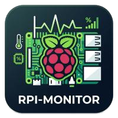

# Welcome to RPi-Monitor documentation !

<figure>

</figure>

**RPi-Monitor** is a software designed to monitor the metrics from GNU/Linux 
system and connected peripherals. It store statistic into local Round Robin 
Database and embed a web server allowing to display current status and statistics.

This documentation is presenting the features provided by **RPi-Monitor** and
explains how to install, configure and use it.

> **Work in progress**
>
> *Pages with the following ribbon are not yet validated and may contain not accurate information.*
>
> <figure>
> 
> </figure>

## Table of Content

- [Keys features of RPi-Monitor](01_features.md)
  - [Screenshots](02_screenshots.md)
- [Getting started](10_index.md)
  - [Installation and upgrade](11_installation.md)
  - [Custom installation](12_custom_installation.md)
  - [Understanding program execution](13_execution.md)
  - [Frequently Asked Questions](14_faq.md)
- [Configuration](20_index.md)
  - [Daemon configuration](21_daemon.md)
  - [Metrics extraction configuration](22_extraction.md)
  - [Interactive Configuration Helper](23_configuration_helper.md)
  - [Web interface configuration](24_web.md)
  - [Addons configuration](25_addons.md)
  - [Alert configuration](26_alert.md)
  - [Configuration templates](27_configuration_templates.md)
- [Usages](30_index.md)
  - [Configuration examples](31_configuration_examples.md)
  - [Configuration using sensors](32_sensors.md)
  - [RPi-Monitor-LCD](33_lcd.md)
  - [Authentication and secure access](34_autentication.md)
  - [Non standard configuration](35_external.md)
- [To go further](40_index.md)
  - [Contributing](41_contributing.md)
  - [Authors and Licenses](42_license.md)
  - [Release note](43_changelog.md)
