# Screenshots

-----

<figure>
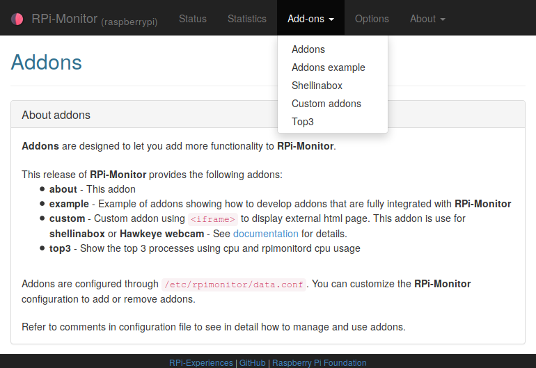
<figcaption>

Addons welcome page explaining how to use Addons

</figcaption>
</figure>

-----

<figure>
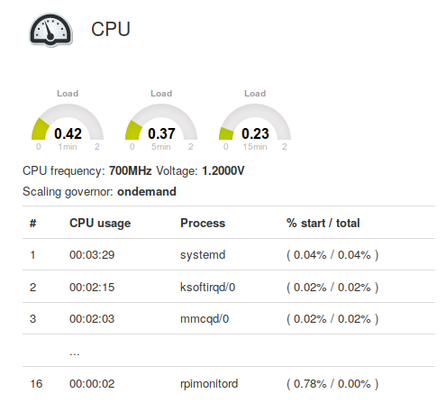
<figcaption>

Top3 addons Addons showing 3 processes using the most time of CPU and `rpimonitord` process cpu usage

</figcaption>
</figure>

-----

<figure>
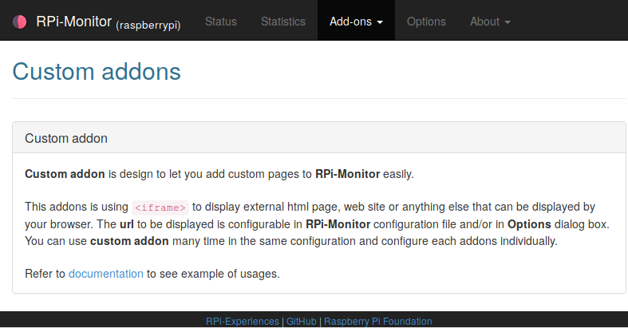
<figcaption>

Custom addon example explaining how to use custom addon

</figcaption>
</figure>

-----

<figure>
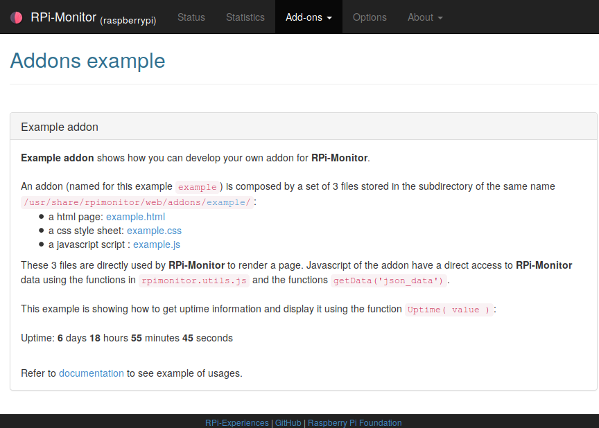
<figcaption>

Example addons explaining how to create an addon for **RPi-Monitor**

</figcaption>
</figure>

-----

<figure>
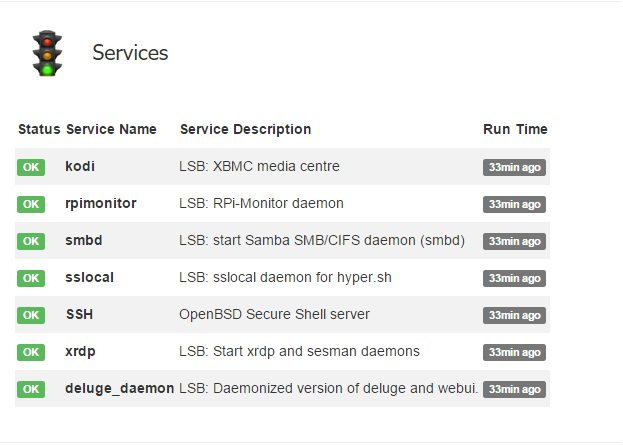
<figcaption>

Advanced services example showing how to use Labels

</figcaption>
</figure>

-----

<figure>
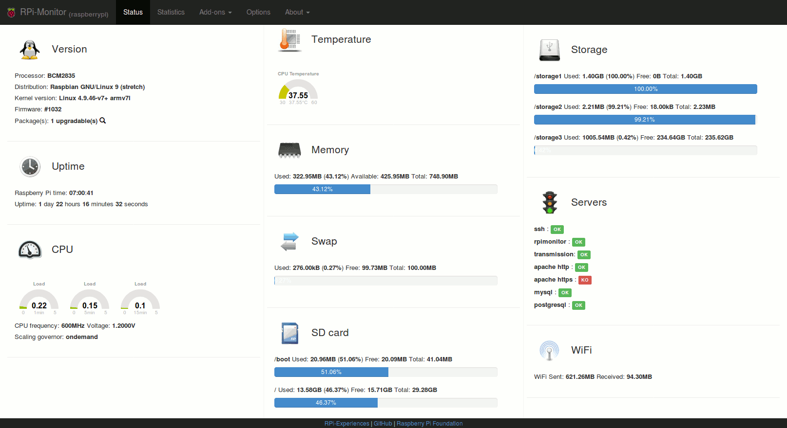
<figcaption>

Status page

</figcaption>
</figure>

-----

<figure>
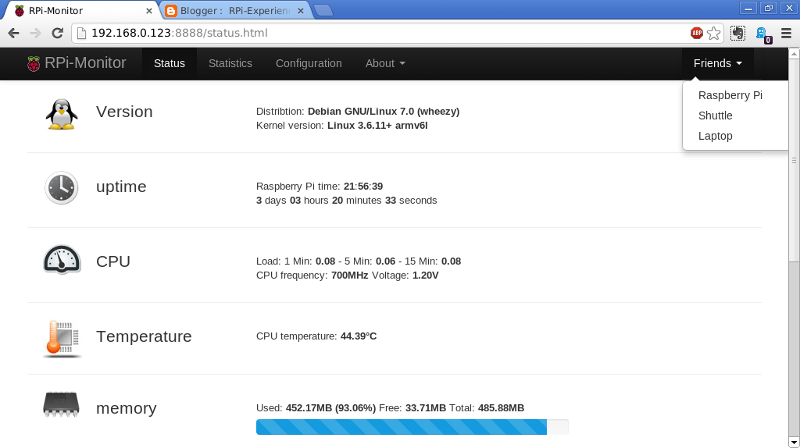
<figcaption>

Status page showing friends

</figcaption>
</figure>

-----

<figure>
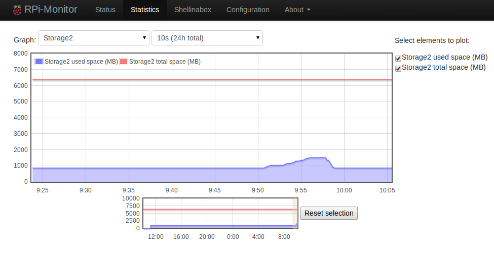
<figcaption>

Statistics showing disk usage

</figcaption>
</figure>

-----

<figure>

<figcaption>

Official Logo

</figcaption>
</figure>

-----

<figure>
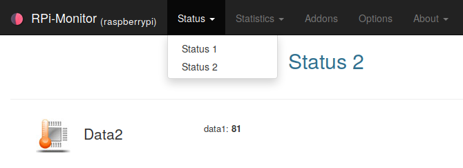
<figcaption>

Multiple status pages

</figcaption>
</figure>

-----

<figure>
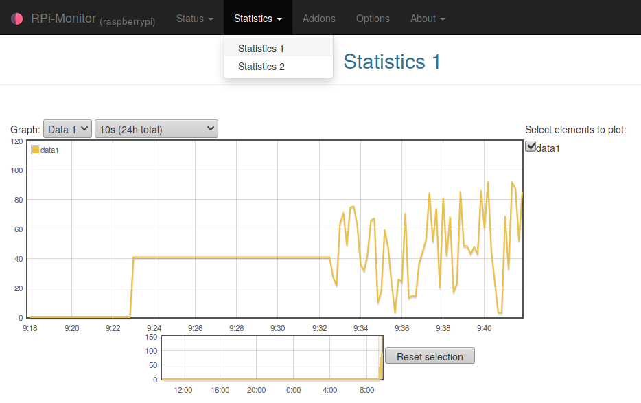
<figcaption>

Multiple statistics pages

</figcaption>
</figure>

-----

<figure>
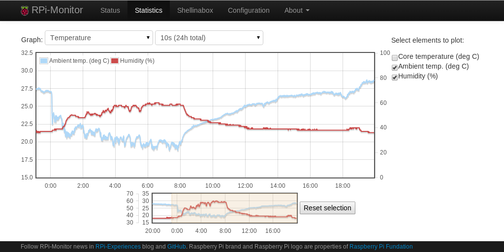
<figcaption>

Statistics with dual axis

</figcaption>
</figure>

-----

<figure>
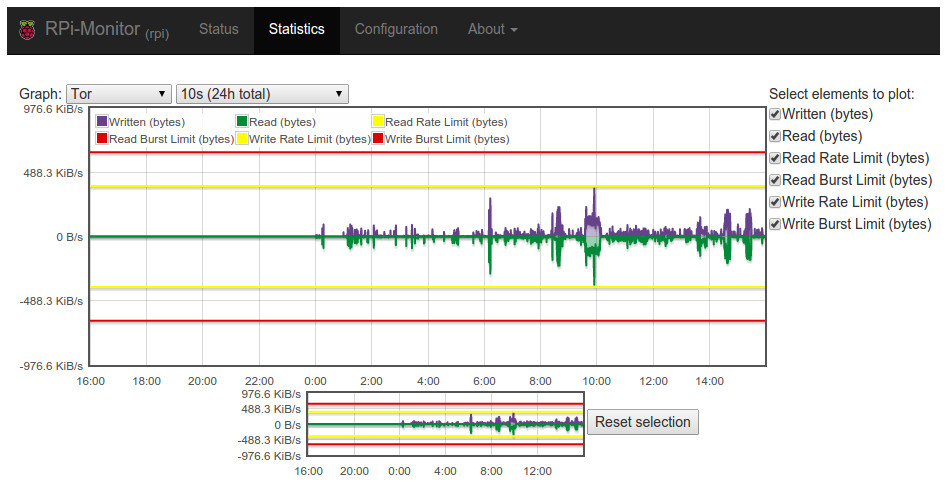
<figcaption>

Example of usage: tor-info

</figcaption>
</figure>
