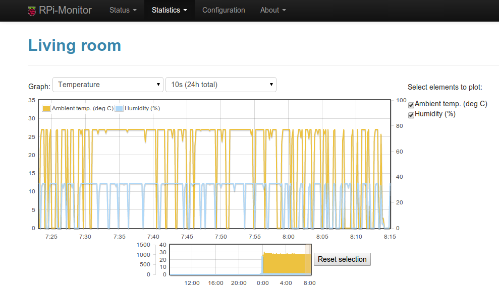

# Frequently Asked Questions

**RPi-Monitor** is displaying `NaN` instead of a value on my "unsupported" distro. Can you fix this issue?
: The installation script targets Debian, Raspberry Pi OS, and Ubuntu. The
  default metrics depend on the operating system and hardware; Raspberry Pi OS
  Bookworm is supported by the current templates. On another distribution or
  device, a missing metric may require a custom source or template. Use the
  [configuration helper](23_configuration_helper.md) to inspect sources and
  generate a configuration example.

 

**RPi-Monitor**'s graphs are not clean and frequently drop down to zero, as in the screenshot below. How can I get a clean curve?
: <figure>
  
  </figure>

  **RPi-Monitor** periodically reads data from programs or files.
  If the program does not respond or the file is empty, the value is unknown.
  This unknown value is drawn as zero in graphs. If, as in the example, the program
  reading the sensor does not provide reliable values, it is recommended to create a
  script that writes the temperature result to a file and configure **RPi-Monitor** to read that file.
  In this case, if the file is not updated, the previous value will be read and displayed in the graphs.

 

**RPi-Monitor**'s web interface is not working; I only see white pages.
: **RPi-Monitor** requires HTML5 local storage and cookies to work properly.
  You should check that both features are enabled in your browser and that no plugin is blocking them.

 

Does **RPi-Monitor** support distribution XXX? Can you make it compatible with distribution XXX?
: The installation script is intended for Debian, Raspberry Pi OS, and Ubuntu.
  Other Linux distributions may work with a community package or manual
  adaptation, but they are not covered by the official installer. The metrics
  themselves are configurable; see the [configuration templates](27_configuration_templates.md).

 

I have a problem running `rpimonitord`: failed "Can't locate _______.pm in @INC ..."
: Check that the installation completed and that the required Perl modules are
  installed. When using the official installer, review its output for missing
  packages and rerun it after installing them.

 

I would like to use my favorite web server instead of the one embedded in **RPi-Monitor**. Is that possible?
: **Yes**, it is possible, but not recommended. The embedded web server in **RPi-Monitor** is
  optimized to minimize SD card usage (it uses shared memory instead of writing data on disk),
  reducing the resources used by the system. The web interface requires some specific features that can only
  be provided by the embedded web server (such as empty `.rrd` file generation to ensure a clean display of graphs).

 

Can you add login/password authentication to the **RPi-Monitor** web interface?
: **No**. I will never add such a feature to **RPi-Monitor**. Why? Because it is
  something complex to do in a clean and fully secure way. Some software packages are
  already designed to do that job well.

  A [solution is proposed in this documentation using nginx](34_autentication.md#authentication-and-secure-access)
  as a frontend.

 

Can I customize **RPi-Monitor**: change the extracted data, add images, or modify texts?
: **Yes**. In **RPi-Monitor**, almost everything is configurable through the
  configuration files. Everything is explained in this documentation.

 

I tried to install **RPi-Monitor** on an OS that is not officially supported and some data are missing. How can I fix it?
: As said previously, in **RPi-Monitor** almost everything is configurable. You
  should find the command to execute or the file to read to get the missing value
  directly in the shell. Once you find it, update the configuration file. Have a look at the
  **RPi-Monitor** configuration chapter and the Interactive Configuration Helper (`rpimonitord -i`).

 

I would like to monitor a cluster of Raspberry Pis with your tool. Is there a way to gather all the data in one node?
: There can be many answers to such a question. One possibility is to use SSH and configure
  **RPi-Monitor** to execute commands on each remote node of your cluster and process the data locally.

  To do so, create one configuration file per node to monitor and use all of them in
  **RPi-Monitor**. The pages feature can be very useful. You can use the main page to display
  some consolidated data in addition to one page per cluster.

  You can also use SNMP capabilities to share data from nodes to a central point.

 

I found a bug in **RPi-Monitor**. How can I share my discovery?
: Open an issue in [GitHub](https://github.com/RPi-Monitor/RPi-Monitor/issues)
  and describe the problem and how to reproduce it.

 

Download bandwidth is shown as negative values. Is this a bug or a feature?
: This is a feature :-). But remember: everything is customizable in **RPi-Monitor**.

 

I want to create a package for my favorite distribution, which is not supported by default. How can I contribute to this project?
: **RPi-Monitor** source code is hosted on GitHub. Refer to the
  [Packaging section of the Contributing chapter](41_contributing.md#packaging) for details.

 

I have an issue with my installation or customization of **RPi-Monitor** and I want to reinstall it from scratch. How can I do it?
: Back up `/etc/rpimonitor` first. For an installation managed by the
  official script, rerun the installer with `--force` to reinstall the current
  release while preserving the configuration. If the Debian package is installed,
  remove it with `sudo apt remove rpimonitor` before switching to the script;
  this keeps the configuration directory.

 

Some data are not extracted correctly at boot, but when I restart `rpimonitord`, everything works again until the next reboot. How can I fix this issue?
: This usually happens when your source is configured with a command without the full path,
  for example `gettemp.sh` instead of `/usr/bin/gettemp.sh`. The first command works in your shell because
  the `PATH` variable is set and the executable is reachable (which is why it also works when you restart `rpimonitord`).
  When the computer starts, the `PATH` variable is not set, so `gettemp.sh` will not work. The solution is to use the full path command `/usr/bin/gettemp.sh`.

 

I just updated my distribution and **RPi-Monitor** is still saying that packages need to be updated. Why?
: The upgradable-packages information is refreshed daily. To update it now,
  run `sudo /usr/share/rpimonitor/scripts/updatePackagesStatus.pl`. The script
  checks for `aptitude`, `apt`, or `checkupdates`.

  See [service and package status](13_execution.md#service-and-package-status).

 

I need better resolution for the readings provided by **RPi-Monitor**. Can we increase the frequency with which **RPi-Monitor** collects the data?
: **Yes**. It is possible to define the RRD structure for each extracted data item.
  Refer to the documentation and man pages to learn how to use this advanced feature.

I want to uninstall **RPi-Monitor**. How can I do it?
: If it was installed as the legacy Debian package, use
  `sudo apt remove rpimonitor`. The script-based installer does not currently
  provide an uninstaller; back up your configuration and data before removing
  installed files or disabling the systemd service.
